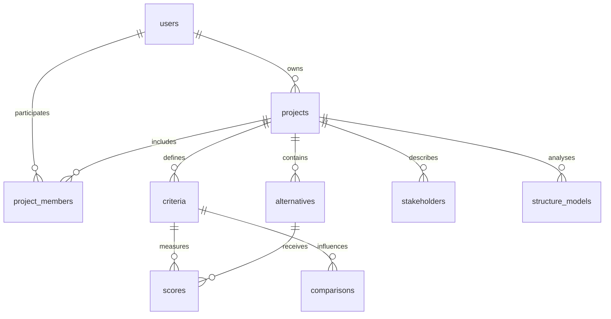
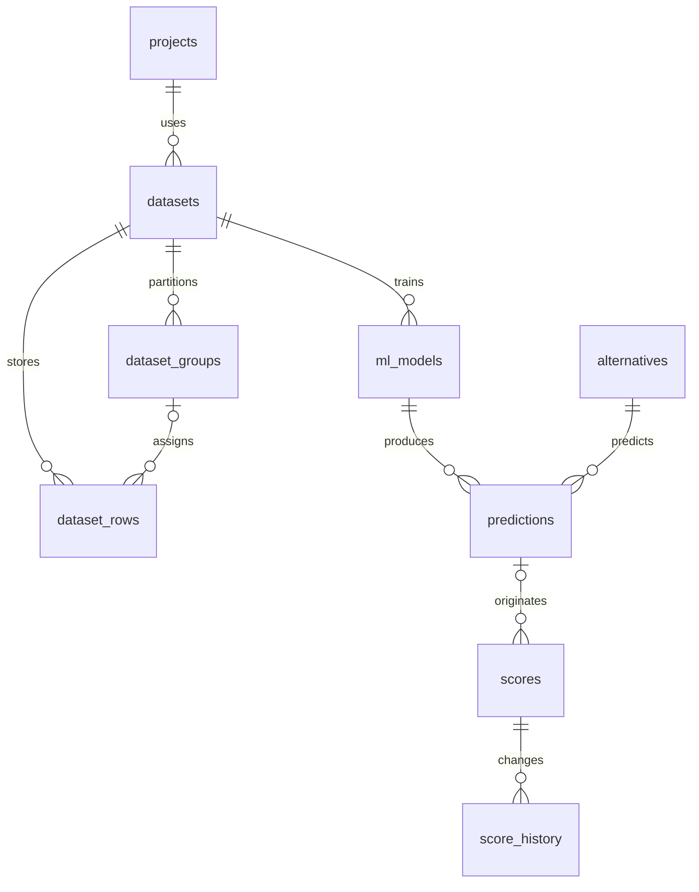
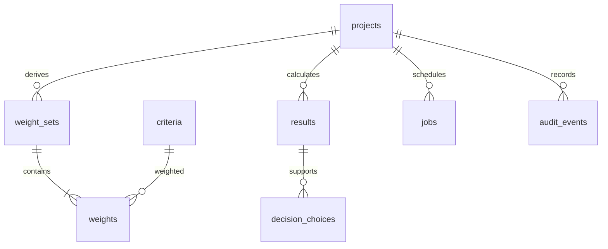

# Схема базы данных СППР «Ноутбук»

Вариант 27. Этап: проектирование и начальная миграция. Дата: 30.10.2026.

## Основание и границы этапа

Схема разработана по разделу 4.3 и таблице 4.2 методического пособия «Системный анализ и принятие решений» и по `docs/technical_specification.md` версии 1.0. Сохраняются рекомендованные предметные таблицы, реестр ML и журнал результатов. Мобильный канал — PWA: таблица `bot_sessions` и связь с MAX не нужны. Роли хранятся в `project_members`, поскольку один пользователь может быть аналитиком одного проекта и экспертом другого.

На этом этапе подготовлены DDL, начальная миграция Alembic и проверки ограничений. Веб-интерфейс, серверная проверка ролей, импорт, обучение из приложения, автоматическое резервное копирование и PWA ещё не реализованы. Наличие таблицы не означает выполнение соответствующей функции.

Расчётное ядро, синтетические CSV и сохранённые модели не изменяются. В схеме 21 прикладная таблица; служебная `alembic_version` создаётся Alembic отдельно. Основная цель — PostgreSQL 16, используются конструкции PostgreSQL 15+. Проверка на установленной у студента PostgreSQL 18 проводится отдельно при применении миграции.

## Состав таблиц

| Таблица | Назначение | Требования ТЗ |
| --- | --- | --- |
| users | Учётная запись, email, хеш пароля, состояние | ФТ-01 |
| projects | Владелец, цель, бюджет, CATWOE, корневое определение, ревизия | ФТ-02, ФТ-08а |
| project_members | Роль пользователя в конкретном проекте | ФТ-01 |
| criteria | Код, единица, направление, источник, порядок | ФТ-03 |
| alternatives | Ноутбуки, характеристики JSONB, порядок | ФТ-04 |
| stakeholders | Интересы, роль, оценки Митчелла и средняя значимость | ФТ-08б |
| datasets | Происхождение, лицензия, SHA-256, seed, параметры и отчёт качества | ФТ-05, ФТ-05а |
| dataset_groups | Единственная часть train/valid/test для каждой чистой конфигурации | ФТ-06 |
| dataset_rows | Строки raw/staging/processed, JSONB, происхождение | ФТ-05, ФТ-05а |
| ml_models | Версии Ridge/Random Forest, метрики, параметры, среда, артефакт | ФТ-06 |
| predictions | Неизменяемый прогноз и снимок входов; объяснение SHAP | ФТ-07, ФТ-08 |
| scores | Текущая таблица решений и ссылка на исходный прогноз | ФТ-07, ФТ-11 |
| score_history | Предыдущее и новое значение, источник, автор, причина | ФТ-07 |
| comparisons | Оценки DEMATEL по эксперту и паре критериев | ФТ-08а |
| structure_models | Снимки входов и результатов DEMATEL | ФТ-08а |
| weight_sets | Метод весов, α, входы и ревизия проекта | ФТ-09 |
| weights | Вес каждого критерия в наборе | ФТ-09 |
| results | Статус, снимок расчёта, параметры, результаты, версия ядра | ФТ-10, ФТ-12, ФТ-16 |
| decision_choices | Выбор ЛПР с результатом, причиной и снимком альтернативы | ФТ-01, ФТ-12 |
| jobs | Состояния длительных операций импорта, генерации, обучения, экспорта | ФТ-05, ФТ-06, ФТ-13 |
| audit_events | Журнал действий пользователя | ФТ-01, ФТ-16 |

## Связи предметной части

## Связи данных и моделей

У raw-строки может ещё не быть группы и части выборки. У processed-строки они обязательны. Привязка группы к единственной части исключает попадание одной конфигурации в train и test внутри одной версии набора. Непересечение блоков GroupKFold и защита от утечки между производными версиями дополнительно проверяются Python-кодом обучения.

## Связи весов и решений

Результат хранит самодостаточный `input_snapshot`: цель, ограничения, отобранные и исключённые альтернативы, признаки, порядок и направления критериев, матрицу, веса, происхождение значений, идентификаторы и версии моделей/данных. `params` содержит v, α и настройки эксперимента, `output` — промежуточные показатели, рейтинги и условия VIKOR. Это контракт записи для будущего Python-сервиса; наличие всех обязательных ключей проверяется Pydantic, а не общим типом JSONB.

## Целостность и история

- Составные внешние ключи с `project_id` запрещают связывать критерии, альтернативы, прогнозы, наборы и модели разных проектов. Они не заменяют проверку прав пользователя: её реализует сервер.
- Положительный конечный тип значений отклоняет ноль, отрицательные числа, NaN и бесконечности. Направления `min/max` и источники `manual/ml/calc` заданы ENUM.
- Частичный уникальный индекс допускает только одну активную модель в проекте. Версия модели и SHA-256 артефакта сохраняются; загружать произвольный joblib через пользовательскую форму не предполагается.
- У оценки ML обязательна ссылка на прогноз той же альтернативы и критерия. При ручной корректировке ссылка сохраняется, требуется причина. Изменение значения, источника или ссылки автоматически добавляет `score_history`; автор указывается в `expert_id`. Сервер дополнительно проверяет автора и соответствие значения исходному прогнозу для источника ML.
- Значение и входы прогноза нельзя обновить; можно дополнить только `explanation`. История моделей и наборов на уровне будущего сервиса не редактируется задним числом: создаются новые версии.
- В наборе весов не менее двух критериев, сумма равна 1 с допуском 0,000001. Проверка отложена до конца транзакции: набор и строки весов создаются вместе. Родительская строка блокируется на время изменения весов; перенос строки между наборами запрещён. Состав критериев и методику комбинации проверяет сервис.
- Изменение проекта, критериев, альтернатив, оценок, влияний и стейкхолдеров увеличивает ревизию проекта. `results.project_revision` сравнивается с текущей ревизией для пометки «устарел». Обновление завершённого результата запрещено: новый расчёт создаёт новую запись. Исторический снимок остаётся пригодным для просмотра.
- Удаление проекта каскадно удаляет его зависимые записи, не затрагивая другие проекты. Внешние ключи истории отложены до конца транзакции, чтобы такой каскад был допустим. Прямое удаление используемого прогноза/модели/набора или оценки с историей отклоняется. Для таких отдельных объектов интерфейс должен предлагать архивирование либо объяснять зависимость, а не уничтожать историю. Удаление проекта — отдельное подтверждаемое действие.
- Пользователи с сохранёнными ссылками деактивируются, а не удаляются. Схема проверяет наличие хеша, но алгоритм Argon2/bcrypt и проверка пароля относятся к будущему модулю авторизации.
- `decision_choices` хранит код и снимок выбранного ноутбука, поэтому смысл решения не зависит от последующего редактирования карточки.

Текущие оценки `scores` — одна итоговая оценка на пару «альтернатива–критерий». Оценки влияний DEMATEL хранятся отдельно по экспертам. Групповая агрегация баллов альтернатив не входит в выбранный объём ТЗ.

## Индексы и типы

Идентификаторы — BIGINT IDENTITY; время — TIMESTAMPTZ. JSONB применяется для признаков, строк данных и снимков переменной структуры. GIN-индекс предусмотрен для поиска по характеристикам альтернатив. B-tree-индексы обслуживают список проектов, версии моделей, историю прогнозов, результаты и журнал. Частичный индекс очереди охватывает только queued/running. Планирование индексов основано на ожидаемых запросах; скорость ещё не измерена, EXPLAIN ANALYZE будет выполнен после загрузки данных.

Значимость Митчелла вычисляется как среднее трёх оценок. Качественный класс определяется Python-правилом и показывается в интерфейсе; он не подменяет веса критериев. Поля вероятности и кластеров из общего примера пособия не включены, поскольку задача ML — регрессия.

## Файлы и порядок применения

- `db_migrations/versions/0001_initial.py` и соседний SQL — зафиксированная начальная миграция.
- `sql/001_initial_schema.sql` — совпадающий DDL для пояснительной записки; вручную параллельно с Alembic его не запускают.
- `db_migrations/versions/0001_down.sql` — обратная миграция. Она удаляет прикладные таблицы и данные; в обычной работе не применяется.
- `alembic.ini`, `db_migrations/env.py` — среда миграций. Секретов в репозитории нет.
- `requirements_database.txt` — дополнительные фиксированные зависимости, существующий файл ML-зависимостей не заменяется.
- `scripts/check_database_schema.py --offline` — проверка согласованности и генерации SQL без подключения.
- `tests/test_database_schema.py` — автономные проверки и отдельная интеграционная проверка PostgreSQL, включаемая через `TEST_DATABASE_URL`.

Сначала файлы добавляются в проект, устанавливаются дополнительные зависимости и выполняется автономная проверка. Затем создаётся отдельная база `coursework_laptop`. Для приложения потребуется отдельная роль с минимальными правами, а не суперпользователь `postgres`. Права создания/изменения схемы принадлежат роли миграций. Настройка ролей, подключения и проверка на Windows выполняются следующим этапом; скрипт не меняет dvdrental и существующие базы.

Для сетевой миграции URL задаётся только через переменную окружения `DATABASE_URL` в формате `postgresql+psycopg://...`; пароль в командах Git и файлах проекта не сохраняется. После настройки подключения выполняется `python -m alembic upgrade head`, затем повторный вызов подтверждает отсутствие повторных изменений. Подстановка пароля в URL должна учитывать URL-кодирование; интерактивная настройка будет дана отдельно.

Миграция написана вручную на SQL PostgreSQL и запускается Alembic в транзакции. Это выбранный вариант управления схемой, предусмотренного пособием; SQLAlchemy ORM ещё не создана, поэтому `--autogenerate` на этом этапе не используется. Новые изменения оформляются новыми ревизиями; файл 0001 после применения не редактируется.

## Проверки и ограничения протокола

См. `docs/database_schema_checks.json`. Проверки выполнены на PostgreSQL 17.5, собранной в WebAssembly (PGlite), в изолированной среде. Это проверка исполнения PostgreSQL DDL и ограничений, а не свидетельство подключения к компьютеру студента или замера PostgreSQL 16/18 на Windows. Проверены создание, откат и повторное создание, внешние ключи, группы выборки, веса, история коррекций, неизменяемость прогноза и результата, каскадное удаление одного проекта. Для отклонённых операций проверен ожидаемый SQLSTATE, чтобы случайная другая ошибка не считалась успешной проверкой.

Alembic также сформировал SQL обеих миграций в автономном режиме. Подключение psycopg к установленной PostgreSQL, повторный upgrade head, отдельная роль, загрузка CSV, EXPLAIN ANALYZE и pg_dump/pg_restore ещё предстоят. Тесты схемы не заменяют 57 тестов расчётного ядра и 24 проверки предыдущего аудита.

## Источники

1. Методическое пособие «Системный анализ и принятие решений», раздел 4.3, таблица 4.2, с. 51–54; вариант 27.
2. `docs/technical_specification.md`, версия 1.0 от 30.10.2026.
3. PostgreSQL 16, Constraints: https://www.postgresql.org/docs/16/ddl-constraints.html (обращение 30.10.2026).
4. Alembic, Tutorial: https://alembic.sqlalchemy.org/en/latest/tutorial.html (обращение 30.10.2026).
